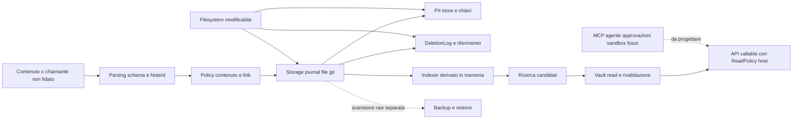

# Audit di sicurezza SuperBrain — A1, A2, A3, B1 e superfici future

Data: 2026-11-01. Sorgenti esaminati: worktree `b1-deterministic-search`,
HEAD `21f0e5627616c50755cc62970cb92123b0f6e3e0`, fix temporale `3c6b1bb`.
Confronto storico della falla: sorgenti index esatti di `338fbf1`.
Questo è un audit e un piano: **nessuna correzione produttiva, refactoring,
modifica della specifica canonica, merge, tag o push è autorizzato da questo file**.
Review indipendente: **GO all'accuratezza del draft di 53 scenari**, nessun Important
documentale residuo. L'integrazione conservativa CR-07 porta il totale a 54:
il reviewer ne ha confermato la coerenza concettuale con il sorgente già letto,
ma non ha riletto il testo finale; il servizio ha bloccato l'ultima richiesta
integrativa. Non dichiarare quella riga come rilettura indipendente completata.
Il GO non riguarda sicurezza del progetto o implementazioni; il verdetto sul
modello avversario resta NO-GO.

## Verdetto e limiti

**NO-GO per dichiarare l'intero progetto sicuro rispetto al modello avversario
qui definito.** Esistono protezioni concrete, ma anche percorsi alternativi
riprodotti che invalidano una dichiarazione globale di fail-closed o riservatezza
dei metadati. Il GO precedente sul fix B1 è limitato alla ricerca temporale
Sensitive e non viene esteso a storage, backup, DeletionLog o processi compromessi.

Risultati principali:

1. **Priorità P0: verifica DeletionLog durante le letture.** Perdita del database,
   riferimento assente o catena manomessa dopo l'apertura possono essere trattati
   come «non cancellato». Riprodotto con vera DPAPI; anche Vault e ricerca corrente
   possono servire un id che prima risultava cancellato. Richiede stato cancellato
   con ciphertext/record ancora presenti o ripristinati e modifica/perdita dei file;
   non è un attacco remoto dimostrato né una rottura di DPAPI.
2. **Date Sensitive: esposizione search corretta, validazione di scrittura assente.**
   Tutti e tre i marker passano ancora schema/gate e restano nei metadati in chiaro
   e nei blob git. Il codice storico li restituiva nella SearchResponse; quello
   corrente no. Rimane necessaria la difesa all'ingresso e la gestione del legacy.
3. **API PII raw:** riprodotti staging fuori dalla root tramite stringhe percorso,
   lettura raw fuori root e sostituzione autenticata di ciphertext tra note sotto
   la stessa master key. Il normale percorso storage valida NoteId; non trasferire
   quella protezione a ogni metodo pubblico di PiiStore.
4. **Persistenza e concorrenza:** journal/hash/idempotenza e pubblicazione atomica
   dell'indice proteggono guasti e interleaving specifici; non costituiscono
   isolamento da un writer filesystem malevolo o un lock globale fra istanze Vault.
5. **DoS misurato:** query ampie leggono fino a 100.000 record. Autorizzazione degli
   strumenti, sandbox, server MCP e protezioni da prompt injection sono ancora
   superfici future, non garanzie implementate.
6. **Backup/restore:** riprodotta la promozione di un record raw senza riga journal,
   rifiutato dal normale secret gate, dopo backup e restore autenticati. L'attaccante
   deve poter piantare il file e indurre un backup/restore legittimo; non serve
   falsificare l'envelope AEAD. La protezione crittografica non certifica l'origine.

Non è una certificazione né un pentest esaustivo. Nessun fuzzing prolungato,
test di power loss reale, campagna di race filesystem, memory dump o verifica
multi-account Windows è stato eseguito. «Non testato» non significa sicuro;
«Mitigated» vale solo per scenario, prerequisiti e confine della relativa riga.

## 1. Attaccanti, asset e confini di fiducia

| Attaccante | Capacità considerate | Limiti e condizioni |
| --- | --- | --- |
| I — contenuto importato malevolo | Controlla testo Markdown/YAML, metadati, istruzioni nei documenti, query se l'host le inoltra | Non possiede automaticamente capability di scrittura, account Windows, chiavi o approvazioni. Una futura importazione deve restare dietro il core. |
| L1 — altro utente locale senza privilegi | Può leggere/modificare solo file consentiti dagli ACL effettivi; può possedere una copia di backup | Non assumiamo accesso universale al profilo Windows. Gli ACL non sono configurati/verificati dal core: l'accessibilità è una precondizione, non un exploit dimostrato. |
| L2 — processo non amministratore con lo stesso account | Può accedere ai file del medesimo utente e normalmente invocare DPAPI nello stesso contesto | DPAPI non è una barriera tra processi dello stesso utente; un processo completamente compromesso non è isolato da una libreria Rust. |
| C — processo concorrente | Secondo handle Vault, altro processo, sostituzione/rollback dei file se ha permessi | Distinguere concorrenza cooperativa da un writer che ignora lock advisory. I Mutex del singolo Vault non coordinano tutti i processi. |
| A — agente compromesso | Controlla argomenti e sequenza degli strumenti che gli verranno esposti | Attualmente non esistono agente, sandbox o tool transport. Se ricevesse filesystem/chiavi o API raw, la policy di alto livello non lo confinerebbe. |
| R — remoto | Per ora: influenza indiretta su contenuti importati, dipendenze e CI | Nessun listener REST/MCP raggiungibile è implementato nei sei crate. Non attribuiamo vulnerabilità di rete a un endpoint inesistente. Prima del transport servono auth, origini, limiti e separazione capability. |

Asset: contenuto e metadati; identità/versione/provenienza delle note; journal e
before-image; cronologia git; chiavi e recovery kit; ciphertext; DeletionLog e
riferimento fidato; backup; correttezza delle citazioni; disponibilità/RAM/CPU;
future approvazioni umane e capability di esecuzione.



Parsing ≠ autorizzazione. Un enum valido non prova che `official`, `verified`,
`project` o `classification` siano affermazioni legittime. Un blob AEAD autentico
non prova che i suoi contenuti provenissero da una scrittura committata e validata.
Un hash uguale non autentica un journal modificabile insieme al file.

### Stato delle fasi nel codice

- **A1:** domain, policy e scrittura storage; NoteId, schema, link, scanner minimo,
  file+versione atomici, journal, commit git. Non esiste un'autorizzazione umana C2.
- **A2:** riconciliazione, before-image, retry e fault injection. Recovery avviene
  all'apertura, non sotto un lock globale che escluda altri processi Vault.
- **A3:** DPAPI, recovery kit, AES-GCM per record, log di cancellazione e backup/
  restore. «Tutte le letture sicure» richiede verificare i percorsi alternativi sotto.
- **B1:** indice in memoria/rebuild concorrente, C4, search/retrieve callable,
  policy di lettura locale. Non è un server autenticato né un sistema RAG generativo.
- **B2/B3/C/D:** grafo, valutazione held-out completa, memoria derivata, transport,
  approvazioni ed esecuzione agente non sono implementati dai soli seam presenti.
  I contratti previsti in `docs/Spec_mvp.md` non sono prove di enforcement corrente.

## 2. Metodo, evidenze e operazioni effettive

Prima di qualunque test sono stati verificati HEAD/worktree, processi cargo/rustc/
b1_scalability e disponibilità esclusiva dei lock target/benchmark. Il benchmark
era già fermo: job-status indica interruzione autorizzata, 19/100 query, nessun
worker/supervisor. **Non è stato duplicato, ripreso o disturbato.** Main e il
worktree A2 non sono stati modificati. Tutti i fixture audit sono sintetici sotto
`.superpowers/security-*`; nessun dato reale o chiave viene stampato.

Esecuzioni nuove, non dedotte dai report precedenti:

- Probe [temporale/store](reproductions/temporal-and-store-probe.rs), con commit
  git reali e DPAPI, indice storico estratto da git e indice corrente: tre campi
  lungo il percorso completo; traversal PII, substitution, Vault/search dopo
  perdita del log, overflow schema e promozione backup/restore di record non gated.
  Output conservato nel file omonimo `.stdout.txt`.
- Probe indipendente [DeletionLog](reproductions/deletion-read-gate.rs): log
  mancante, riferimento mancante e catena alterata. Output reale omonimo conservato.
- `cargo test -p domain -p policy --locked --quiet`: 32 + 14 test passati.
- `cargo test -p index --locked --test b1_search --quiet`: 31 test passati.
- `cargo test -p storage --locked --lib sec_00 --quiet`: 4 caratterizzazioni
  avversarie passate. Sono test che confermano anche debiti aperti, non quattro
  attestazioni di mitigazione.
- `cargo deny check --hide-inclusion-graph`: advisories/bans/licenses/sources OK,
  con eccezione advisory esplicita e warning duplicati/allowance già descritti.
- Nessuna nuova esecuzione della suite completa 518, mutation campaign o benchmark
  oneroso: i risultati precedenti restano contesto storico, non prove nuove di audit.

Un primo probe rustc ha incontrato identità di crate diverse fra rlib cached;
il runner temporale usa ora un piccolo package isolato con risoluzione offline
coerente. Gli errori di compilazione non sono trattati come esiti di sicurezza.
Un tentativo `commit_staged` con percorso avversario è stato rifiutato dalla
protezione before-image: la riproduzione positiva riguarda `stage` e `get`, non
asserisce un successo di ogni API di scrittura raw.

### Catalogo delle sorgenti primarie

I riferimenti Sxx nella matrice sono a sorgenti realmente letti; linee relative a
HEAD audit, più nomi di funzione per ritrovarli dopo modifiche. Test esistenti
sono citati come limiti/casi specifici, non come attestazione globale.

| ID | Sorgenti e punti verificati |
| --- | --- |
| S01 | [domain/note.rs](../../crates/domain/src/note.rs):27–41,77–160 `NoteMetadata`, `parse_frontmatter`, `require_string`; `schema.rs` enum/errori; `migration.rs` separato dal parse ordinario. |
| S02 | [storage/note_id.rs](../../crates/storage/src/note_id.rs):63–120 `NoteId::parse`; [policy/gate.rs](../../crates/policy/src/gate.rs):69 `evaluate`; [secrets.rs](../../crates/policy/src/secrets.rs):39–110 due pattern ed eccezioni. |
| S03 | [propose.rs](../../crates/storage/src/propose.rs):179–265, `commit_sensitive`, `pointer_record`; parse e gate prima del primo intento; frontmatter copiato verbatim, solo body nel PII store. |
| S04 | [vault.rs](../../crates/storage/src/vault.rs):28,408,441,685–769,855–899,981,1153+,2042,2067,2101: serializzazione, retry, startup, letture/hash, lock locali, gate cancellazione, canonicalizzazione. |
| S05 | [atomic.rs](../../crates/storage/src/atomic.rs):31–79 temp/create/sync/rename; [journal.rs](../../crates/storage/src/journal.rs):15 schema,246 CAS,316 lookup; [git.rs](../../crates/storage/src/git.rs) TreeBuilder e operation marker. |
| S06 | [recovery.rs](../../crates/storage/src/recovery.rs):170 `reconcile`,326 intent,478 deletion,550 PII/hash,617 rollback,723 content persisted,919 journal committed; [fault.rs](../../crates/storage/src/fault.rs) hook di test. |
| S07 | [keys.rs](../../crates/vault-security/src/keys.rs):32 Zeroizing,167 load/create,213+ DPAPI FFI; [recovery_kit.rs](../../crates/vault-security/src/recovery_kit.rs):31–34 parametri,77 KDF,97 generate,139 parse,151 unwrap. |
| S08 | [pii_store.rs](../../crates/vault-security/src/pii_store.rs):214–242 hash/AEAD,296 open,336–359 percorsi,403 stage,441 commit,570 before-image,591 gated read,637 raw get, decrypt_buffer: nessuna AAD identità/versione. |
| S09 | [deletion_log.rs](../../crates/vault-security/src/deletion_log.rs):124–177 riferimento DPAPI,476 open/create,558 lock,654 deletion,741 lookup,767 chain,832 reconcile; log/reference fratelli nello store. |
| S10 | [backup.rs](../../crates/vault-security/src/backup.rs):426 HKDF,487 walk raw,526 PII raw,639/660 backup,723 restore,878+ controlli; [restore.rs](../../crates/storage/src/restore.rs):161,267,353 prepare,478+ promote e lock. |
| S11 | [document.rs](../../crates/index/src/document.rs):55–199 tipi/parser/testo; [search.rs](../../crates/index/src/search.rs):277–390 candidati/read/rivalidazione/score/excerpt,418 filtri typed; [trigram.rs](../../crates/index/src/trigram.rs), [bm25.rs](../../crates/index/src/bm25.rs). |
| S12 | [indexer_impl.rs](../../crates/index/src/indexer_impl.rs):138–338 mutex/versioni/rollback,404 rebuild; [concurrency_tests.rs](../../crates/index/src/indexer_impl/concurrency_tests.rs):127–439 interleaving deterministici; [time_range.rs](../../crates/index/src/time_range.rs) C4. |
| S13 | [api/lib.rs](../../crates/api/src/lib.rs):69 check/envelope; [retrieve.rs](../../crates/api/src/retrieve.rs):26; [search.rs](../../crates/api/src/search.rs):14; [policy/read.rs](../../crates/policy/src/read.rs) capability booleane host. |
| S14 | [b1_search.rs](../../crates/index/tests/b1_search.rs):331,396,437,473; [b1_confidentiality_boundary.rs](../../crates/index/tests/b1_confidentiality_boundary.rs); [b1_api.rs](../../crates/api/tests/b1_api.rs):119,168,286 `held_out_labels`. |
| S15 | [a3_confidentiality_boundary.rs](../../crates/storage/tests/a3_confidentiality_boundary.rs):108,150,198,293,342; [a3_backup_restore.rs](../../crates/storage/tests/a3_backup_restore.rs); test interni vault/recovery/deletion_log. |
| S16 | [CI](../../.github/workflows/ci.yml), [deny.toml](../../deny.toml), Cargo.lock e manifest; solo job Ubuntu, azioni/toolchain non fissate a digest, eccezione unsafe-libyaml. |
| S17 | [Spec_mvp.md](../Spec_mvp.md):33,70–74,C2/C3/C5/Fase D: requisiti futuri, non enforcement; [eval/rag](../../eval/rag/README.md) e runner: scaffold anti-contaminazione. |

## 3. Root cause esatta dei temporali Sensitive

### Percorso riprodotto, non solo inferito

Per ciascuno di `created`, `updated`, `event_period`, il probe:

1. costruisce YAML Sensitive con marker sintetico al posto della data;
2. chiama il vero parser e `Gate::evaluate`, quindi `propose_and_commit` con
   PiiStore reale: risultato Committed, nessun bypass manuale del gate;
3. verifica via `Vault::read_note` che il frontmatter contenga il marker e il
   body privato sia sostituito da `pii://`; verifica marker nel `.record` e blob git;
4. ricostruisce l'indice storico e corrente leggendo quello stesso Vault;
5. esegue una query reale e ispeziona la SearchResponse, non solo i postings.

Output per tutti e tre i campi:

```text
schema_accepts=true gate_passes=true storage_plaintext_metadata=true git_metadata=true
old_search_response_exposes=true current_search_response_exposes=false
```

| Passo | Funzione e fatto verificato | Responsabilità reale |
| --- | --- | --- |
| Input/parsing | S01 `parse_frontmatter`, righe123–125, chiama `require_string` per i tre campi | **Primo punto di accettazione semantica:** `require_string`155–160 controlla solo `as_str()`, non il formato temporale. Il dato è valido come String, non come data. |
| Tipi | `NoteMetadata.created/updated/event_period: String` | Il tipo non testimonia validazione. Il testo è ancora non fidato dopo il parse. |
| Gate | S02 `Gate::evaluate`: link, classificazione/store e due pattern di segreti | Non ha una regola date; un marker personale ordinario non è un segreto AKIA/PEM. Non è un malfunzionamento AES o un bypass di quel controllo specifico. |
| Scrittura | S03 `commit_sensitive` e `pointer_record`; S04 serialize/journal/git | Body cifrato, **frontmatter verbatim**: valore invalido arriva in chiaro nel file e nella cronologia. Nessun validation pass successivo lo corregge. |
| Document storico | `338fbf1:document.rs`, `structured_fields_as_text` includeva le tre clone di String; `build_text_searchable(Sensitive)` restituiva quel testo | **Punto che rende ricercabile il dato:** promozione dell'input non validato nella allowlist testuale. La premessa «closed enum/date/id» era falsa. |
| Indici | `TrigramIndex::insert`, `Bm25Index::insert` ricevono `text_searchable` | Tokenizzano il testo fornito: non sono validatori di classificazione o di date. |
| Query | S11 search rilegge Vault e ricostruiva lo stesso Document; excerpt Sensitive = testo consentito dal Document | La rivalidazione di versione/classificazione era corretta, ma ripeteva la policy difettosa; non poteva rimuovere un campo ritenuto ammesso. |
| Corrente | `3c6b1bb` typed Option per filtri, sette campi non temporali per testo Sensitive | Blocca il percorso postings/excerpt, non l'ingresso e non la storia git. Lo stesso input continua a passare schema/gate. |

**Causa primaria dell'esposizione search:** un confine di fiducia è stato
attraversato assumendo validazione semantica mai eseguita; String arbitraria
promossa a testo «strutturato sicuro». **Fattori contribuenti:** allowlist di nomi
senza tipi validati; test originari con date nominali, body/source/relations ma
senza canary nei campi ammessi; medesimo builder in indexing e rivalidazione;
schema permissivo e serializzazione del frontmatter in chiaro.

Il primo difetto di validazione è upstream del gate; la funzione che espone il
testo era il builder Document storico. Non attribuiamo a trigram/BM25, AES-GCM,
DeletionLog o alla logica di ordering una responsabilità non supportata dalla
riproduzione. Il nuovo finding DeletionLog è indipendente da questa root cause.

## 4. Matrice di copertura

Stati ammessi: **Mitigated**, **Partially Mitigated**, **Vulnerable**,
**Not Tested**, **Not Implemented**. «Fonte» indica conclusione dal codice;
«probe» una riproduzione eseguita. Probabilità qualitativa condizionata ai
prerequisiti, senza numeri inventati o CVSS remoto. P0/P1/P2 sono ordine di
intervento, distinto dalla gravità.

La matrice contiene 54 scenari: 14 Mitigated nei soli confini dichiarati,
20 Partially Mitigated, 9 Vulnerable, 5 Not Tested, 6 Not Implemented. Non sono
54 vulnerabilità indipendenti né una percentuale quantitativa di sicurezza.
Aggiornato per B5.SEC (2026-11-16): FS-02/FS-03 passano da Partially
Mitigated a Mitigated (contro il threat model B5 dichiarato, non contro
Administrator/SYSTEM); FS-04 passa da Vulnerable a Partially Mitigated
(Approach A: residuo esplicitamente documentato, non eliminato).

### Filesystem, schema, storage e recovery

| Threat ID | Scenario e prerequisiti | Asset | Confine | Protezione esistente | Codice/test/evidenza | Stato | Gravità e impatto | Probabilità e assunzioni | Rischio residuo | Raccomandazione/fase |
| --- | --- | --- | --- | --- | --- | --- | --- | --- | --- | --- |
| FS-01 | I fornisce id con traversal, device Windows o case alias al core | Record/identità | String→path | NoteId canonico lowercase, max128, no slash/.., nomi riservati | S02 `NoteId::parse`; test di traversal/case/device; chiamato da S03 prima dell'intento | Mitigated | Alta se bypassato: letture/scritture errate | Bassa nel percorso core con NoteId; non estendere ai metodi raw | Non ferma sostituzioni FS né PiiStore &str | Preservare guard; unificare tipo ID, P1 |
| FS-02 | L/C pianta symlink statico fuori root prima del controllo | File esterni | Path→FS | Verifica sull'handle aperto (B5.SEC), non più sul solo path | `crates/storage/src/handle_safety.rs::open_verified` (O_NOFOLLOW/FILE_FLAG_OPEN_REPARSE_POINT + root-confinement sull'handle); tutti i 12 call-site reali di produzione in vault.rs/recovery.rs/restore.rs riagganciati (commit b5-brain-api-mcp `2167ba8`..`a3f074a`); test invertiti `record_symlink_resolving_inside_the_vault_root_is_rejected_as_an_alias_not_followed`, `sec_001_toctou_window_between_path_check_and_write_is_closed`, `sec_001_toctou_read_side_no_longer_leaks_an_outside_records_version_or_bytes` | Mitigated (contro il threat model B5: processo locale non privilegiato con accesso FS) | Alta: accesso fuori root se non mitigato | Bassa con root privata; chiusa per il threat model dichiarato, non per Administrator/SYSTEM | Finestra residua di scala microsecondo tra ri-verifica pre-rename e `std::fs::rename` (Approach A, non handle-relative — vedi FS-04) | SEC-001 CHIUSO per B5; residuo documentato, non "race-free" |
| FS-03 | Hard-link o symlink interno tra record, L/C ha permessi di creazione | Identità e integrità | Entry FS→record | Verifica sull'handle aperto: link-count==1 e identità risolta, non solo containment del path | `open_verified` rifiuta `nlink()!=1` (Unix) / `nNumberOfLinks!=1` (Windows); test invertiti `sec_002_both_read_and_write_paths_reject_both_aliasing_shapes`, `sec_003_hard_link_aliasing_is_invisible_to_canonicalization_after_a2` (ora asserisce rifiuto su entrambi i path) | Mitigated (stesso threat model di FS-02) | Alta integrità/aliasing se non mitigato | Chiusa per il threat model dichiarato | Stesso residuo di FS-02/FS-04 (finestra pre-rename) | SEC-002/003 CHIUSI per B5; residuo documentato |
| FS-04 | C sostituisce componenti dopo check, oppure temp path prima di File::create | Vault/file esterni | Check→open/rename | `write_verified_atomic`: directory padre verificata su handle (`open_verified_dir`), temp file nella stessa directory, re-verifica immediatamente prima del `rename`, verifica identità immediatamente dopo | `crates/storage/src/handle_safety.rs::write_verified_atomic`/`open_verified_dir`; tentata e scartata una vera primitiva handle-relative (`SetFileInformationByHandle`+`FileRenameInfoEx`+`RootDirectory`): fallisce con `ERROR_INVALID_PARAMETER` su questa build Windows (10.0.26200), confermato sia in Rust (windows-rs 0.62.2, tipi reali) sia in una reference C indipendente contro header Windows SDK reali (MinGW-w64 gcc), eliminando ogni spiegazione di binding — vedi continuity `d248e4`/`d249ef` | Partially Mitigated | Alta se la finestra residua viene vinta | Bassa: richiede vincere una race a grana di singola syscall, non solo accesso FS generico | Finestra residua tra re-verifica e `std::fs::rename`, accettata esplicitamente contro il threat model B5 (non Administrator/SYSTEM, non un attaccante capace di vincere quella race precisa) | Approach A adottato come decisione esplicita dell'utente; non degradato a path-only rename senza re-verifica; B6+ può rivalutare Approach B (ACL directory) se il threat model si allarga |
| FS-05 | A/adapter passa percorso raw a PiiStore senza NoteId; possiede lo store | PII/FS | API low-level &str→path | Il solo percorso storage valida ID | S08 stage/live_path; probe: stage ../../ fuori root e get ../ decifra canary | Vulnerable | Alta: lettura/scrittura oltre root configurata | Alta se adapter inoltra &str; nessun endpoint remoto corrente | `commit_staged` tentato è stato rifiutato; non tutti i metodi hanno lo stesso esito | ID validato condiviso e containment di ogni API, P1 prima di adapter |
| ST-01 | I tenta SQL injection in id/valori | Journal/log | Dato→SQL | Parametri rusqlite; query dinamica composta da clausole fisse | S05 `params!`, S09 SELECT parametrizzati; NoteId aggiunge restrizione | Mitigated | Alta se query interpolasse input | Bassa per le query lette | Non autentica il database contro modifica diretta | Preservare binding; fuzz/query review nuove API, P2 |
| ST-02 | Due thread sullo stesso Vault scrivono stessa versione/id, retry con payload diverso | Versione/commit | Chiamata→stato committato | Mutex per nota, confronto expected, operation id+hash binding, state CAS | S04 `ensure_retry_matches*`, `write_record_impl`; test `concurrent_writers_sharing_one_vault_instance_on_same_version_only_one_succeeds` | Mitigated | Alta lost update/replay | Bassa entro singolo Vault e processi cooperativi | Garanzia non vale automaticamente per altre istanze | Mantenere test; vedere ST-03, P1 |
| ST-03 | Secondo Vault/processo apre stesso journal/root durante write o recovery | File/journal/git | Istanza→altra istanza | CAS per operation row; Mutex sono locali | S04 `note_lock`981; S06 reconcile all'open, nessun lock globale per vault | Not Tested | Alta: conflitti, rollback su lavoro altrui | Plausibile se host apre due handle; riproduzione deterministica non eseguita | Nessun per-note compare-version+rename atomico cross-process dimostrato | Decidere single-writer lock o supporto multi-writer, test barriere/processi, P1 |
| ST-04 | Crash fra file, journal, git, PII; retry di operation interrotta | Durabilità/rollback | Memoria→persistenze multiple | Intent e hash prima degli effetti; before-image; reconcile idempotente/fail-closed | S04–S06 fault matrix e test di rollback/invalid hash/retry; schema CAS | Partially Mitigated | Alta: perdita o falso successo | Ridotta nei faultpoint testati; nessun power-loss fisico nuovo | Errori di sync, controllo FS ostile e multi-handle non coperti dai soli hook | Fault I/O reali, power-loss Windows/Unix, ST-03; P1/P2 |
| ST-05 | L/C altera file e journal insieme o ripristina entrambi | Autenticità/versioni | FS→fonte di verità | SHA256 lega record all'ultima riga committata; stato/parse con fail-closed | S04 read_note_locked, S05 lookup/CAS; test mismatch rifiutato | Partially Mitigated | Alta: modifica coordinata non autenticata | Media solo con scrittura su DB+record | Hash non è MAC/ancora antirollback; SQL DB è modificabile dall'account | Definire FS trusted o autenticazione/ancora, P1 decisione |
| ST-06 | Staging git di altra operazione o marker commit falsificato | Cronologia | Shared index→commit | TreeBuilder per singola operazione; OID journal primario e hash contenuto | S05 git.rs, lock git locale, test commit isolati | Partially Mitigated | Media/alta: attribuzione cronologia | Bassa con singolo host; C con accesso .git resta forte | HEAD/repo/marker non firma; lock non globale | Test HEAD mutato/istanze; firma se richiesta, P2 |
| ST-07 | I invia schema_version enorme o sconosciuta | Compatibilità/gate | YAML numero→u32 | Solo as_u64 seguito da cast | S01:98–104 `as u32`; probe4294967297→1 | Vulnerable | Media: bypass discriminante versione | Alta se input libero; impatto sicurezza dipende future migrazioni | Non equivale di per sé a esecuzione codice | Checked conversion+allowlist versioni/migrazioni esplicite, P1 |
| ST-08 | I usa campi sconosciuti, enum invalidi o tipi YAML errati | Coerenza schema | Input→NoteMetadata | Required keys, deny unknown relations, enum stretti | S01/S02; 32 domain +14 policy rieseguiti | Mitigated | Media: interpretazioni incoerenti | Bassa per membership/tipi verificati | Non prova semantica temporale, versione, dimensioni o veridicità | Mantenere guard; validazione canonica separata, P1 |

**Qualifica FS-03:** i test SEC post-A2 appena rieseguiti distinguono realmente
le strade: `read_note` rifiuta alias verso contenuto con hash diverso o senza
propria riga journal, ma `write_record_impl` legge la versione pre-write dal
percorso FS. Il test `sec_002_read_path_rejects_both_aliasing_shapes_but_write_path_pre_read_does_not`
mostra una nota nuova che eredita versione/byte di un'altra nota nella propria
before-image. Il rename sostituisce il symlink, non sovrascrive il target:
non affermiamo che ogni symlink produca una scrittura arbitraria sul file-vittima.
L'hard-link e le race restano debiti distinti dalla mitigazione hash del read path.

### Cifratura, chiavi e confidenzialità

| Threat ID | Scenario e prerequisiti | Asset | Confine | Protezione esistente | Codice/test/evidenza | Stato | Gravità e impatto | Probabilità e assunzioni | Rischio residuo | Raccomandazione/fase |
| --- | --- | --- | --- | --- | --- | --- | --- | --- | --- | --- |
| CR-01 | L1/offline altera bit di ciphertext senza chiave | Body PII/kit | Ciphertext→plaintext | AES-256-GCM, nonce random12B, data key random32B per stage, CSPRNG | S07/S08; test wrong key/tag/ciphertext; codice decritta con errore su tag | Mitigated | Alta se plaintext accettato | Bassa assumendo libreria/OS CSPRNG e segretezza chiave | Non lega identità, non garantisce disponibilità o unicità formale dei nonce | Preservare AEAD e limiti volume/format; CR-02, P1/P2 |
| CR-02 | C copia envelope PII A sulla entry B, stessa master key, senza conoscerla | Identità contenuto | Filename/id→AEAD | Tag autentica byte, non note_id/versione; niente AAD | S08 `encrypt/decrypt`; probe `get_unless_deleted(B)==bodyA` | Vulnerable | Alta integrità; non escalation multiutente dimostrata | Media con scrittura sui ciphertext | Recovery confronta hash atteso; reader PII stabile no; API retrieve non decifra body | AAD identità/versione/formato e migrazione; test swap/replay, P1 |
| CR-03 | Furto keyfile da altro account/offline, oppure processo dello stesso utente | Master key | OS principal→DPAPI | DPAPI current-user, nessun LOCAL_MACHINE; MasterKey non Debug e Zeroizing | S07 FFI; test unwrap; documentazione Microsoft sotto | Partially Mitigated | Critica se chiave ottenuta | Bassa per altro account senza credenziali; alta per L2 pieno | Nessuna barriera intra-account/sandbox o ACL esplicito nel core | Definire account/ACL/capability e proteggere recovery, P1 prima D |
| CR-04 | Due first-open simultanei o fingerprint scorretto da caller raw | Chiave/durabilità | Bootstrap FS→master | PiiStore calcola fingerprint; existing ciphertext senza key rifiutato | S07 load_or_create read→generate→fs::write; S08 fingerprint; test lost-key | Not Tested | Alta: chiavi divergenti/orfanaggio | Plausibile su bootstrap concorrente; non riprodotto | Nessun create_new/lock init; API MasterKey accetta None caller-supplied | Bootstrap esclusivo e verifica reload; test due processi, P1 |
| CR-05 | Kit rubato e passphrase debole/vuota scelta dall'utente | Master key/backup | Passphrase→KDF | Argon2id64MiB/t3/p1, salt16B, GCM; niente policy entropia | S07 generate/derive/unwrap, test wrong pass e parametri | Partially Mitigated | Critica se brute force riesce | Dipende entropia, non dal solo nome Argon2id | Attacco offline non ha rate limit efficace; parametri non impongono password forte | UX/entropia e policy backup-kit, P1; benchmarking KDF separato |
| CR-06 | L2/process dump, swap/pagefile o crash dump | Chiavi/plaintext RAM | Buffer→memoria OS | MasterKey/KDF Zeroizing; StagedNote Drop wipe | S07,S08 arrays/Vec ordinari; S10 subkey/snapshot; nessun dump test | Partially Mitigated | Alta confidenzialità | Media con accesso processo/OS; non testato | Data key, unwrap Vec, copie stack/heap non tutte azzerate | Revisione zeroize/endpoints e policy dump, P1/P2; non promettere wipe SSD |
| CR-07 | Recupero legittimo dopo perdita del profilo/context DPAPI con kit/passphrase disponibili | Disponibilità di vault e stato cancellazioni | Kit portabile→restore operativo | Kit ricostruisce la master key senza DPAPI; reference usa invece DPAPI separata | S07 unwrap_master_key e test byte-identical; S09 DpapiTrustedReferenceStore; nessun test end-to-end secondo account/macchina con log storico | Not Tested | Alta: recupero può restare bloccato dal reference, correttamente fail-closed | Condizionata a perdita credenziali/profilo; non test operativo eseguito | Recuperare master key non dimostra recuperabilità/freschezza dell'ancora cancellazioni; niente fallback non autenticato | Decidere recovery dell'ancora e provare cross-profile reale; P1 piano C5 |
| CF-01 | I scrive nuovo body Sensitive tramite core corretto | Body in file/git/temp | Write→persistenze | Gate richiede store; solo pointer record nel vault, ciphertext nel PII store | S03/S08/S15 test git/journal/temp, probe reale body non nel record | Mitigated | Alta se body esposto | Bassa nel percorso nuovo Sensitive con host corretto | Non copre metadata, dati prima Internal, backup vecchi o raw reads | Preservare e testare percorsi alternativi, P1 |
| CF-02 | Marker libero in date Sensitive tenta postings/excerpt | Dati temporali | Metadata→index/response | Fix3c6b1bb: niente testo temporale, typed Option per C4, invalidNone | S11/S14; probe oldtrue/currentfalse per3campi;31search rieseguiti | Mitigated | Alta nell'ex finding search | Bassa per il preciso contributo dei tre campi corrente | Non valida scrittura né cancella metadati/git; stessi token possono essere in altri campi ammessi | Difesa ingresso e legacy sotto, P1 |
| CF-03 | I inserisce identificativi in date/project/source/relations/slug Sensitive; lettore file/git o retrieve autorizzato | Metadati personali | Input→metadati in chiaro | Search esclude body/source/relations/date, non tutta la metadata; retrieve conserva frontmatter | S01/S03/S11/S13; probe storage/git date marker=true | Vulnerable | Alta: confidenzialità C3 metadata non generale | Alta con input libero + lettore di superfici ammesse | Esempi testati non provano sanitizzazione metadati; id/progetto non sono necessariamente opachi | Validazione date minima; decisione policy metadati/opaque IDs/retrobonifica, P1 |
| CF-04 | I usa classification:secret tramite normale gate o restore parse | Segreti | YAML→Classification | Nessuna variante Secret; parser rifiuta valore e gate non la ammette | S01/S02/S10 prepare chiama parse; test policy/domain | Mitigated | Alta | Bassa per valore esplicito | Non riconosce segreti etichettati Internal o offuscati | Preservare distinzione CF-05, P1 |
| CF-05 | Segreto reale etichettato Internal, offuscato o di forma non AKIA/PEM; eccezione costruita dal caller | Credenziali/git | Contenuto→secret gate | Due regex, scan whole note, eccezioni legate a hash+id+pattern | S02 secrets.rs; test nominali; version field non seleziona repertori diversi | Partially Mitigated | Alta/critica se token funzionante | Media con input arbitrario; nessun detector universale | Niente detector PII generico; approved_by/reason non autenticati | Scanner stratificato e approvazioni host reali; no promessa detection totale, P1 |
| CF-06 | A/input con facoltà write dichiara official/verified o declassa Sensitive→Internal | Trust/provenienza/PII | Input→policy semantica | Enum/link validi; nessuna prova autore/approvazione per quei cambi | S01–S03; C2/C1 successivi in S17 | Partially Mitigated | Alta: poisoning/declassificazione | Condizionata alla facoltà write; nessun tool remoto corrente | Search rivalida ciò che è committato, non l'onestà dell'asserzione | Policy transizioni/provenienza/approvazione esatta, prima C/D, P1 |
| CF-07 | Errori/Debug/log host espongono valori o chiavi YAML malevoli | Metadati/segreti | Errori→output/log | API enum sanitized, no logging core automatico; MasterKey non Debug | S01 ValidationError conserva raw unknownkey/enum; S13 errori sanitized; S15 canary subset | Partially Mitigated | Media/alta secondo log | Dipende se host registra errori raw; non osservato log reale | NoteMetadata Debug e errori low-level non redazione globale | Error DTO sanitizzati e test log capture su ogni wrapper, P1 |
| CF-08 | L1 legge journal e prova dizionario di body PII corto | PII a bassa entropia | Plaintext→digest pubblico | Nessun literal body nel journal, ma SHA256 non salato | S08 content_hash; S04 pii_content_hash; S15 test literal exclusion | Partially Mitigated | Media: conferma di ipotesi sul body completo | Media solo per payload indovinabili e journal leggibile | Hash non cifra e non impedisce guess offline; non equivale a decrittare body arbitrario | Valutare digest autenticati/keyed e ACL, con recovery/migrazione, P1/P2 |

### Cancellazione, backup e restore

| Threat ID | Scenario e prerequisiti | Asset | Confine | Protezione esistente | Codice/test/evidenza | Stato | Gravità e impatto | Probabilità e assunzioni | Rischio residuo | Raccomandazione/fase |
| --- | --- | --- | --- | --- | --- | --- | --- | --- | --- | --- |
| DL-01 | Cancellazione pending/completed con log autentico intatto; ciphertext ancora presente | Non consultabilità | Log→read | Qualunque riga is_deleted blocca nota; lock per deletion/reconcile | S09 SELECT, S08 gated read; probe before_missing_log_rejected=true | Mitigated | Alta | Bassa per lo scenario log intatto | Si invalida se lo stato autorevole non viene autenticato: DL-02/03 | Conservare pending-as-deleted; non usare risultato senza verifiche, P0 |
| DL-02 | Perdita/rinomina del DB dopo open; riferimento DPAPI resta; nota cancellata conserva/restaura i file | Dati cancellati | FS→consumer gate | Startup riconcilia se ref presente; read usa open(create) | S09 open476; S08 get_unless_deleted591; S04 gate2042; due probe, anche Vault/search corrente | Vulnerable | Critica nel contratto C5: serve dati già negati | Media con perdita/file-writer e vecchi byte presenti; non remoto | DB vuoto appena creato diventa false; startup precedente non protegge lettura successiva | Open-existing verificato, snapshot coerente chain/ref+lookup, P0 |
| DL-03 | C altera catena/note_id o rimuove riferimento dopo startup | Dati cancellati/integrità | Untrusted log→is_deleted | verify_chain/reconcile esistono ma non nel consumer read | Probe: chain verificabilmente rotta, get_unless_deleted serve note-a; reference mancante non blocca note-b | Vulnerable | Critica/alta: verifica saltata | Media con modifica FS; niente DPAPI forgery necessario | Errore I/O→failclosed non basta se dati leggibili ma non fidati | Verifica autentica per esposizione e errori uniformi, test alternative paths, P0 |
| DL-04 | Replay di una vecchia coppia log+reference DPAPI autentici, o perdita di entrambi | Storia cancellazioni | Disco→monotonia | Ref autentica bytes e confronti generazione; no ancora esterna | S09 reconcile (None,None)=genesis; S08 file fratelli; nessun replay-pair test eseguito | Partially Mitigated | Alta: resurrection se anche vecchi contenuti disponibili | Condizionata a vecchia coppia+FSwrite; fonte, non nuovo probe | Autenticità non è freschezza; entrambi mancanti ambigui rispetto primo avvio | Decidere ancora separata/TPM/servizio o limite esplicito; bootstrap, P1 |
| DL-05 | A/caller con PiiStore usa get/get_before_image invece di reader gated | PII cancellati | Recovery privilege→consumer | Contratto/documentazione e test di callsite, nessuna capability separata | S08 rawget637 e beforeimage570 pubblici per recovery cross-crate | Partially Mitigated | Alta se adapter li espone | Alta se caller compromesso li possiede; host stesso non isolabile via lib | Non è prova bypass remoto; superficie privilegiata intenzionale ma pubblica | Capability/servizio recovery separati, allowlist tool, P1 prima adapter |
| DL-06 | Vecchie copie, hardlink, git prima di riclassificazione, backup e master/recovery key conservati | Cancellazione fisica/retroattiva | Unlink/log→supporti/copie | Tombstone e reader/restore selettivi; stage cifrato | S08 wrapped data key inclusa nel file; S10 backup conserva envelope; niente erase SSD | Partially Mitigated | Alta: recupero offline con copia+chiave | Alta se copie+chiave esistono; bassa senza chiave per ciphertext | Non è crypto-erasure di tutte le copie; upgrade Sensitive non bonifica storia | Politica retention/revoca/incident response e consenso bonifica, P1/P2 |
| DL-07 | Restore di backup vecchio durante nuova cancellazione cooperativa | Note cancellate | Backup→promozione | Verifica log/ref, esclusione note e recheck sotto lock cross-process | S09 lock558; S10 restore+promote; test a3_backup_restore e interleaving | Partially Mitigated | Alta | Ridotta nei casi cooperativi testati | Non protegge coppia replay, log mutato ignorando lock, read gate difettoso | Ripetere dopo P0, test multiprocesso e logloss durante promote, P0/P1 |
| BK-01 | C pianta record non committato/non validato dal FS; host esegue backup/restore legittimo | Journal/gate/provenienza | Raw scan→backup autentico→record committato | Envelope AEAD; prepare valida forma/id, non gate completo | S10 walk487/backup660/prepare353; probe: normale gate rifiuta fixture PEM sintetica, sourceVault NotFound, restore la rende leggibile | Vulnerable | Alta: promozione fuori percorso ordinario riprodotta | Media se FS scrivibile e host backup/restore; nessuna forgery AEAD | Backup non usa Vault::read_note né snapshot journal; authenticated≠già gated | Backup autorevole committato + policy restore esplicita, P1 |
| BK-02 | L/C introduce symlink directory/file o ciclo durante backup | File esterni/disponibilità | Walk root→FS | Esclusione dotfiles; envelope cifra ma non confina percorso | S10 collect_vault_files usa path.is_dir/read seguendo link; nessun visited set/handle confinement | Vulnerable | Alta: inclusione fuori root o ciclo DoS | Media solo con entry malevole/permessi FS; fonte, non probe escape | Non equiparare «backup cifrato» a «contenuto correttamente selezionato» | Walk su handle/filetype nofollow e budget, P1 |
| BK-03 | Attaccante modifica backup blob senza chiave | Confidenzialità/integrità backup | Blob→restore | AEAD sotto HKDF subkey distinta, tag e parser, checks deletion | S10 derive_backup_subkey426, restore723; test tamperedblob/subkey/wrongkey | Mitigated | Alta | Bassa con chiave segreta e nonce corretti | Non autentica la correttezza della raccolta né impedisce replay vecchio con chiave | Mantenere AEAD; separare BK-01/DL-04, P1 |
| BK-04 | Journal/root PII non-dot dentro vault, restore other_files collide con journal aperto | DB/chiavi/layout | Snapshot file→destinazione | NoteId e guard destinazione/clobber per note preparate | S10 walk ricorsivo include non-record; staged.other_files promossi; configurazioni consentite dai constructor | Not Tested | Alta: overwrite/stato incoerente potenziale | Condizionata a layout collidente; nessuna riproduzione qui | Test usuali con journal esterno non coprono tutti i layout | Escludere controlfiles, verificare collisioni/case/links, test layout, P1 |

### Ricerca, API e superfici future

| Threat ID | Scenario e prerequisiti | Asset | Confine | Protezione esistente | Codice/test/evidenza | Stato | Gravità e impatto | Probabilità e assunzioni | Rischio residuo | Raccomandazione/fase |
| --- | --- | --- | --- | --- | --- | --- | --- | --- | --- | --- |
| IX-01 | Indice stale propone contenuto eliminato, cambiato o declassificato; excerpt non corrisponde | Risultati/citazioni | Cache→fonte corrente | Ogni candidato read_note, Document attuale, match/filter/rescore; version citata è letta | S11 search277–390; S14 paused-index/reclassification31 test passati | Partially Mitigated | Alta privacy/integrità | Bassa con Vault gate sano; DL-02/03 riprodotti invalidano assunzione globale | Rivalidare un reader vulnerabile non ripara il gate; niente snapshot cross-note o recall totale | Fix P0 gate; mantenere revalidation e test differential, P0/P1 |
| IX-02 | Rebuild v1 sovrascrive live v2 o Current prematuro | Postings/versioni | Rebuild↔live | Mutex unico, high-water version, atomic both-postings/metadata, rollback | S12 13 barrier tests; source fix; historical bug distinto dal temporale | Mitigated | Alta lost recall/falseCurrent | Bassa nei interleaving coperti | Current=ultima versione osservata, non storage prima callback; DoS/OOM resta | Preservare lock-order/no Vault callback; test ogni seam futura, P1 |
| IX-03 | Risultati di altro progetto o filtro tempo/status non rispettato | Scope/query | Richiesta→risultato | ActiveOnly default, Explicit visibile, typed C4 e filtri su record corrente | S11/S12/S14; boundary/DST/valid date tests | Mitigated | Media/alta secondo dati | Bassa nello scope funzionale search | ProjectScope non è ACL multiprogetto; retrieve globale se capability concessa | Non vendere come auth multiutente; policy transport futura, P1 |
| IX-04 | Query BM25 comune o filtered con k piccolo causa fan-out enorme | CPU/latency/storage | Query→lavoro non limitato | k limita output, nessun deadline/rate/candidate budget | S11 candidate_ids allpositives; misure reali10k/100k, B1-PERF-001 | Vulnerable | Alta disponibilità | Alta con accesso query e corpus grande; misurata | 100k: fino100000reads, singola query40min; no conclusioni P95 da19righe | Piano prestazionale separato, limiti senza perdere correttezza, P1 prima remoto |
| IX-05 | Note/query/YAML enormi, crescita corpus/rebuild e response body intero | RAM/CPU/processo | Input→allocazioni | NoteId bounded; altre dimensioni non bounded | S01 parse Value; S11 excerpt wholebody; S12 rebuild; RSS100k~3.73GB storico | Not Tested | Alta: OOM/stack/tempo | Plausibile se import/input non limitati; no stress/fuzz nuovo | Nessun budget per body/query/results/cache o concorrenza; catch_unwind non cattura abort OOM | Limiti ingresso/backpressure/cancel/rebuild budget; test bounded, P1 |
| IX-06 | Label held-out o domanda benchmark entrano nell'indice | Valutazione/qualità | Runner→runtime | Directory dev/calibration/test e listing record root-only | S14 held_out_labels e S17 runner; non è sandbox contro copia intenzionale nel vault | Partially Mitigated | Media: risultati qualità falsati | Bassa per path accidentalmente annidati; alta se copie dirette | B3 dataset/soglie/freeze completi non eseguiti | Freeze/hash/contamination audit B3, P2 |
| AP-01 | Caller fornisce ReadPolicy permissiva o accede a storage senza wrapper | Autorizzazione | Host→core | Default-deny per operazione, check ogni call wrapper | S13 check69; policy bool host-owned, constructors pubblici | Partially Mitigated | Alta se esposto a caller non fidato | Dipende dal futuro host; L2/host compromesso già privilegiato | Non è autenticazione né capability process boundary | Host identity/capability separati; nessun modello costruisce policy, P1 prima transport |
| AP-02 | Remoto invoca MCP/REST, CSRF/origin, enumerazione/auth bypass | Vault/PII | Rete→core | Nessun listener implementato, API sono funzioni Rust | S13 e Cargo workspace; specifica S17 soltanto futura | Not Implemented | Potenziale critica | Nessuna raggiungibilità diretta dimostrata ora; futura dipende binding/auth | Assenza transport non prova correttezza del suo futuro design | Read-only MCP, auth/origini/sessioni/limiti/TLS dove necessario; prima esposizione, P1 |
| AP-03 | Agente falsifica/replay approvazione o modifica proposal dopo approvazione | Scrittura/esecuzione | Modello→autorità umana | Contratto C2 prevede proposal/hash/version/TTL/canale separato | S17 solo; nessun token/CLI approval implementato nel workspace | Not Implemented | Potenziale critica | Non raggiungibile come strumento ora; alta se futura CLI condivisa | Gate contenuto non implementa approvazione umana | Spec C2 prima toolswrite; replay/TOCTOU/canale ostile, P1 |
| AP-04 | Documento/snippet contiene istruzioni «approva/esfiltra/esegui» | Tool authority | Dato recuperato→istruzione | Search deterministica non esegue testo; nessun modello nel core | S11/S13 esecuzione assente; nessuna suite prompt-injection futura eseguita | Not Implemented | Potenziale critica se agent tools | I controlla documento; sfruttamento richiede orchestratore futuro | Citazione/trust string non autorizza azioni; escaping soloUI non basta | Dati non autoritativi, allowlist capability, approvazioni esterne, test egress/indirect injection; P1 prima D |
| AP-05 | Codice malevolo legge chiavi, approval socket o esce dalla sandbox | Host/chiavi/rete | Agente→OS | Nessuna sandbox/agent crate implementata | S17 Fase D e tabella crate, non Cargo members | Not Implemented | Potenziale critica | Nessun executor corrente; rischio condizionato alla futura esecuzione | Worktree da sola non è sandbox; stesso account DPAPI è pericoloso | Boundary OS verificato, mount/token/socket/egress tests; P1 prima D |
| AP-06 | Embedding, riassunti, allegati/cache futuri trattengono PII cancellata | Dati derivati | Fonte→derivato | Seam/claim n2io, nessuna implementazione concreta | S17 e current Cargo; index-only tests non coprono questi output | Not Implemented | Potenziale alta | Nessun attacco corrente su sottosistema assente | Non chiudere n2io globalmente né inferire cancellazione cascata | Threat model e canary per ciascuna nuova superficie C/B/D, P1/P2 |

### Dipendenze e delivery

| Threat ID | Scenario e prerequisiti | Asset | Confine | Protezione esistente | Codice/test/evidenza | Stato | Gravità e impatto | Probabilità e assunzioni | Rischio residuo | Raccomandazione/fase |
| --- | --- | --- | --- | --- | --- | --- | --- | --- | --- | --- |
| SC-01 | Dipendenza/action/toolchain compromessa o advisory ignorato | Build/runtime | Supply chain→binario | Cargo.lock, cargo-deny e licenze consentite | S16; exception RUSTSEC-2024-0449 unsafe-libyaml, review2027-04-26; action@v4/toolchainstable/tool install non versionpinned | Partially Mitigated | Alta | Non quantificata; lock non autentica maintainer/CI | Advisory unmaintained non è prova exploit; denyverde non certifica codice | Pin SHA/tool versions, --locked CI, review eccezione/parser safeRust, P1/P2 |
| SC-02 | Segreti/PII introdotti fuori core o in commit via libgit2 | Credenziali/git | FS/developer→storia | Solo scanner runtime minimo e test fixture | S02/S05/S16: nessun hook/scanner CI implementato nei file esaminati; git2 commit non impone hookCLI | Not Implemented | Alta | Media con workflow manuale/import | C3 doppio controllo e scansione storia non soddisfatti dal solo gate | Secret/PII scanning con eccezioni controllate e rotazione incidenti, P1 |
| SC-03 | Bug platform-specific/FFI/C nativo non coperto dal CI Ubuntu | Chiavi/memoria/durabilità | Rust→DPAPI/libgit2/SQLite/OS | Rust safe per molto codice; FFI DPAPI delimitata; test localiWindows | S07 unsafe FFI, S16 solo Ubuntu; libgit2/SQLite bundled e parserunsafe | Partially Mitigated | Alta potenziale | Non stimata; nessun exploit memorysafety verificato | WindowsDPAPI, reparse points, powerloss non provati da jobLinux | Windows+Linux CI avversario, fuzz codec/FFI review/supply-chain, P1/P2 |

## 5. Piano di correzione e difesa in profondità — da approvare

### P0: reader DeletionLog autentico e non inizializzante

Non aggiungere soltanto `exists()` prima di `open`: rimarrebbe una TOCTOU.
Separare creazione esplicita del log da **open-existing/no-create** dei reader.
Una lettura deve accettare soltanto una vista coerente di catena completa,
riferimento autentico e stato nota. Coordinare con writer/reconcile legittimi:
il recheck deve coprire la decisione di esposizione, non essere un controllo
preliminare scollegato dal lookup. File mancante, ref mancante/tampered, catena
rotta, generazioni incompatibili e bootstrap ambiguo devono negare l'esposizione.

Test RED necessari su PiiStore, Vault, search/retrieve, recovery e restore:
perdita DB dopo open, ref rimasto; ref assente/corrotto dopo open; edit note_id
con chain invalida; log sostituito con vecchio log; operazione di cancellazione
fra verifica e lettura; pending deletion con ciphertext ancora vivo. Barriere o
hook, nessuno sleep come scheduler. Provare anche note non-Sensitive già ritirate.
Non indebolire fail-closed per far passare fixture di genesis: definire genesis
esplicitamente. Il replay di una **coppia** autentica vecchia non è risolto da
questo solo fix: richiede una decisione sull'ancora monotona/limite di fiducia FS.

### P1: temporali, minimo verificabile e struttura

Il fix minimo search **già presente** va mantenuto, non reimplementato:
temporali Sensitive fuori dal testo, Option validati per C4, nessun fallback,
rivalidazione current e ordering rebuild/live invariati.

La correzione minima **ancora da autorizzare** è validare semanticamente ogni
campo temporale **prima del primo intento journal** nella scrittura ordinaria,
con errore tipizzato sanitizzato. Una singola routine canonica deve definire
YYYY-MM-DD/RFC3339 e intervalli non vuoti, offset/timezone e limiti; la grammatica
va approvata rispetto alla specifica e agli input già supportati, non cambiata
unilateralmente. Il parser canonico non deve dipendere da `index` in `domain`.
Rifiutare anche schema_version oltre u32 o non supportata, senza troncamento.

Difesa strutturale proposta: DTO di input raw distinto da metadati validati;
tipo temporale Date/Instant/EventInterval con costruttori chiusi e validatore
condiviso nel livello appropriato del grafo dipendenze. Il gate riceve prove di
validazione, non String arbitraria trattata come data. La serializzazione deve
preservare la semantica approvata; niente normalizzazione che cambi periodo o
reference date. Il builder dei postings rimane una allowlist esplicita separata
dai campi filtrabili. I nomi dei campi non sono una prova di innocuità del valore.

Per gli altri metadati Sensitive serve una decisione separata: quali possono
essere pubblici/indicizzabili, quali richiedono id opachi, sanitizzazione o
cifratura. Anche source/project/relazioni/raw retrieve/frontmatter e slug in git
devono essere valutati secondo C3, non solamente i tre campi di questa falla.

### Record esistenti, recovery e compatibilità

Prima inventario **in sola lettura** dei record e backup non conformi; report con
conteggi/id opachi, mai eco dei valori personali. Nessuna riscrittura automatica,
conversione di date ambigue, purge o modifica della storia git. Decidere fra
quarantena, correzione esplicita con nuova versione e read-legacy controllato.
Una lettura legacy non può rendere indicizzabile il valore invalido né dichiararlo
validato; C4 su quel campo resta non-match/errore esplicito secondo la decisione.

Non irrigidire il parser usato da recovery senza piano: un record prima accettato
potrebbe impedire reopen/restore. Distinguere envelope/versione/hash affidabili da
validità temporale; mai far passare come successo una migrazione fallita. Restore
deve conservare i gate di cancellazione e una policy esplicita per legacy e dati
non passati dal gate, invece di assumere che AEAD autentichi quel precedente.
Prima della bonifica, considerare journal/before-image, git/history, backup, log,
indice derivato e dati prima Internal. Bonifica/rotazione distruttiva richiede
approvazione distinta e procedura di incidente; nessun wipe SSD garantito.

### Ulteriori pacchetti P1/P2, separati

- **P1 filesystem/capability:** NoteId condiviso validato per ogni PiiStore API;
  reader pubblico gated, raw recovery separato; handle nofollow/regular/link-count,
  temp esclusivi e root binding. Supporto multi-Vault o lock single-writer esplicito.
- **P1 envelope PII:** AAD con contesto/identità/versione/formato, senza usare
  identità non fidata dal file come sola autorità. Piano di migrazione delle copie
  legacy e replay-version; non trattare dati vecchi senza binding come nuovi.
- **P1 backup:** raccolta solo di versioni committate tramite confine autorevole,
  snapshot coerente note/PII/journal; no scan di controlfiles/chiavi, no symlink walk;
  policy di restore/gate su ogni sorgente e test layout/clobber. Nessuna scorciatoia
  sui lock cancellazione e sull'idempotenza della promozione.
- **P1 disponibilità:** definire limiti input/query, cancellation, backpressure,
  budget rebuild/RAM e concorrenza. Il piano B1 prestazionale resta una proposta
  separata; non cappare arbitrariamente i candidati perdendo risultati corretti.
- **P1 prima di MCP/D:** host identity, read-only transport, approvazioni legate a
  proposta/hash/versione/TTL, canale umano separato, sandbox senza chiavi/token/socket,
  tool allowlist ed egress. Retrieved text non può conferire capability o approvare.
- **P2 delivery/assurance:** CI Windows/Linux e versioni/SHA fissati, scansione
  segreti/storia, review eccezione YAML, fuzz parsing/codec e fault I/O reali,
  memoria/zeroize e politiche retention/recovery kit.

### Criteri di accettazione e test aggiuntivi

| Pacchetto | RED avversario e verifiche richieste prima di GO |
| --- | --- |
| Temporali/create | Marker e forme malformate per ogni campo; create rifiutata prima di file/journal/git; errori senza valore; validi C4, RFC/offset e calendario approvato. |
| Temporali/update | Nessun incremento versione o record parziale su reject; expected_version e retry stessooperationId invariati; errore non registrato come commit. |
| Reclassification/rebuild/search | Internal→Sensitive, index lag/fault, late rebuild v1/livev2, entrambi postings e Debug; C4 per created/updated/event/any, DST e `[start,end)`; confronto oracle correttezza. |
| Legacy/recovery/restore | Ogni stato C1×fault con record validi/invalidi, versioni schema sconosciute, backup vecchi, quarantena e retry; nessun falso Current o bypass DeletionLog; nessun overwrite distruttivo. |
| Deletion read gate | Tutte le varianti DL-02/03 sui consumer, mismatch/ref rollback, record nonSensitive cancellato, perdita/replace file fra check e use; multi-handle/processo cooperativo. |
| PII/FS/crypto | Traversal slash/backslash/device/hardlink/reparse/race; decrypt staged fuori root rifiutato; swap envelopeA→B e replay versione rifiutati; wrong key/tag, assenza chiave e initrace. |
| Backup/provenienza | Record senza journal o gate, snapshot durante write/rollback, input Secret/PII raw, controlfile collision, link/cycle, destination non vuota e clobber; restore parziale ripetibile. |
| Agent/transport futuri | Indirect prompt injection, tool-output injection, impersonazione approval, replay/TTL/proposal-mutata, CSRF/origin, path/command injection, socket/host-files/egress dalla sandbox. Nessun test nominale sostituisce l'isolamento OS. |

Gate di implementazione: review indipendente del threat model e delle API;
TDD RED/GREEN, mutation mirata sui guard, regressioni C4/recovery/restore,
Clippy/Deny e suite appropriate su entrambe piattaforme. Misure di performance
solo su fixture e protocollo autorizzati, distinguendo core misurato e modificato.

## 6. Decisioni da approvare e arresto

### Esito della revisione indipendente

Il reviewer ha verificato sorgenti e percorsi alternativi senza partecipare a
implementazioni produttive, ha costruito/eseguito il probe DeletionLog e ha
riesaminato l'audit finale e il probe del parent. **GO per accuratezza e prudenza
dell'audit**, nessun Important documentale residuo; **non** GO alla sicurezza del
progetto o all'implementazione del piano. Il GO riguarda il draft a 53 righe:
CR-07 è un'integrazione successiva Not Tested, confermata concettualmente ma non
riletta nella sua forma finale per blocco del servizio di review. Sono stati
controllati in particolare
falsi negativi, prerequisiti FS/host, distinzione storico/corrente, scope dei
Mitigated e rischi di attribuire autenticità/freschezza improprie alle primitive.

### Decisioni richieste

1. Regola genesis/open-existing e sincronizzazione della verifica DeletionLog
   **P0**, con posizione/identità del riferimento fidato e comportamento fail-closed.
2. Ancora antirollback realmente indipendente oppure esplicito modello FS trusted;
   rollback della coppia autenticata non può essere escluso dal solo DPAPI.
   Decidere anche il recupero dell'ancora dopo perdita del profilo: il recovery kit
   della master key non è già una prova di restore completo cross-profile.
3. Grammatica temporale canonica, confine Raw→Validated e trattamento del legacy;
   checked schema versions. Nessun cambiamento a `docs/Spec_mvp.md` in questo audit.
4. Politica di classificazione dei metadati e autorizzazione di promozioni/declassi;
   eventuale bonifica di cronologia/backup è una decisione distinta.
5. Single-writer vs multi-process support; API recovery/PII/capability e formato
   AEAD con identità/AAD, inclusa migrazione.
6. Fonte autorevole del backup e policy di validazione al restore, con layout
   esclusi e compatibilità dei backup già prodotti.
7. Budget DoS e confine MCP/approvazioni/sandbox prima di esposizione a un agente.

Implementazione **non avviata**. Il benchmark B1 resta interrotto19/100 come
autorizzato prima di questo audit, invariato. Il documento e le riproduzioni
sono il risultato da revisionare e approvare; non segnano chiusi i finding aperti.

## Fonti esterne primarie di supporto

La conclusione sul codice deriva dalle sorgenti sopra. Per i limiti delle
primitive, sono stati verificati [Microsoft CryptProtectData](https://learn.microsoft.com/en-us/windows/win32/api/dpapi/nf-dpapi-cryptprotectdata)
(scope credenziali utente/macchina, non isolamento intra-account),
[RFC9106](https://www.rfc-editor.org/rfc/rfc9106.html) (Argon2 e scelta parametri;
il codice usa64MiB/t3/p1, non un generico certificato di sicurezza) e
[RustSec RUSTSEC-2024-0449](https://rustsec.org/advisories/RUSTSEC-2024-0449.html)
(unsafe-libyaml non mantenuto; non è una prova di exploit concreto nel progetto).
Non ripetiamo l'affermazione nel commento del recovery kit su una «floor OWASP»
come se fosse una proprietà verificata automaticamente dei parametri del codice.
